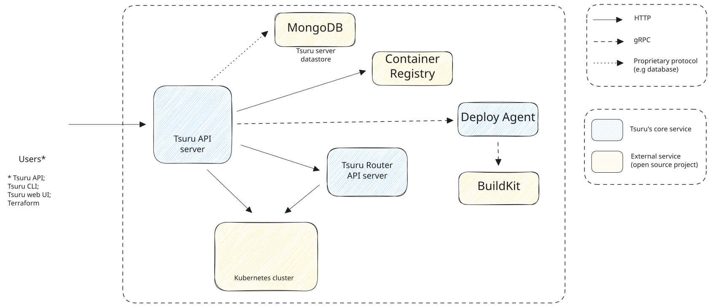

# Architecture

!!! tip "How can I improve the above diagram?"

    Feel free to help us by improving and keeping the above diagram up to date.
    It was created using Excalidraw's whiteboard.
    Click [here][Arch diagram link] to access the most updated version available.
    After changing anything, you should share the new export link with us.

## Tsuru API server

<small>This service is part of Tsuru's core services.</small>

The web API where the Tsuru users interact with.
It's responsible for almost everything since Tsuru workloads[^1] creation until deployment workflow and troubleshooting operations.

| | |
|-|-|
| Source code: | :simple-github: [tsuru/tsuru](https://github.com/tsuru/tsuru) |
| API specification (Swagger 2.0): | :simple-swagger: [Tsuru API](../reference/api.md) |

Besides serving the API, the same process emits an **event** for every write operation (the
audit trail behind `tsuru event list`, see [Events](../admin_guides/events.md)), keeps a small
**in-memory ring buffer of recent app logs** for `tsuru app log` (pod logs remain the source of
truth; see [Observability](../admin_guides/observability.md#application-logs)), exposes Prometheus
metrics on `/metrics` and exports traces over **OpenTelemetry** when `OTEL_EXPORTER_OTLP_ENDPOINT`
is set. All specifications in this repository are written in Swagger 2.0, not OpenAPI 3.

## MongoDB

The only datastore. Tsuru API server stores in it the expected state of Tsuru workloads[^1], users,
teams, roles, tokens, clusters, pools, plans and the full event history. There is no queue or cache
service (no Redis).
It must be a [MongoDB] server, version 6 or newer (the Helm chart ships MongoDB 8).

| | |
|-|-|
| Source code: | :simple-github: [mongodb/mongo] |

## Container Registry

Service to store and distribute container images of Tsuru workloads[^1].
It must be compliant with [Docker Registry API][Docker registry] or [OCI distribution specification][OCI distribution spec].

| | |
|-|-|
| Source code: | :simple-github: [distribution/distribution] |

## Deploy Agent

<small>This service is part of Tsuru's core services.</small>

The service is responsible for intermediating the build and push process of Tsuru workloads[^1] container images to the container registry.
Tsuru API server calls it over gRPC (cluster setting `build-service-address`); it generates a Containerfile for source deploys, drives BuildKit, pushes the image and reports back the `Procfile` and `tsuru.yaml` it found. Platform images are built the same way.

| | |
|-|-|
| Source code: | :simple-github: [tsuru/deploy-agent] |

## BuildKit

Service to build and push container images from a container file recipe.

| | |
|-|-|
| Source code: | :simple-github: [moby/buildkit] |

## Tsuru Router API

<small>This service is part of Tsuru's core services.</small>

The web API service which Tsuru updates the app's service backend.
Its reference implementation, kubernetes-router, creates a Kubernetes `Service` and, in `ingress`/`ingress-nginx`/`istio-gateway`/`gateway-api` modes, an `Ingress` or gateway route per app. See [Managing routers](../admin_guides/managing_routers.md).

| | |
|-|-|
| Source code: | :simple-github: [tsuru/kubernetes-router] |
| API specification (Swagger 2.0): | :simple-swagger: [Tsuru Router API](../reference/router_api.md) |

## Ingress controller

The component that actually receives app traffic. kubernetes-router only writes `Ingress` objects; an ingress controller running in the cluster (ingress-nginx in the Helm chart, class `tsuru-nginx`) turns them into a reachable endpoint. Any controller the router mode supports can be used.

| | |
|-|-|
| Source code: | :simple-github: [kubernetes/ingress-nginx] |

## Kubernetes cluster

The [Kubernetes] cluster where Tsuru API should run the Tsuru workloads[^1] on.

| | |
|-|-|
| Source code: | :simple-github: [kubernetes/kubernetes] |

[^1]: Tsuru apps and jobs

[Arch diagram link]: https://excalidraw.com/#json=82LzV5xb0cOcKAEjYFXLK,rRJ14gZdbHKrlYSmFG_rFw
[MongoDB]: https://www.mongodb.com/
[Docker registry]: https://docs.docker.com/registry/
[OCI distribution spec]: https://github.com/opencontainers/distribution-spec
[Kubernetes]: https://kubernetes.io/

[mongodb/mongo]: https://github.com/mongodb/mongo
[distribution/distribution]: https://github.com/distribution/distribution
[tsuru/deploy-agent]: https://github.com/tsuru/deploy-agent
[moby/buildkit]: https://github.com/moby/buildkit
[tsuru/kubernetes-router]: https://github.com/tsuru/kubernetes-router
[kubernetes/kubernetes]: https://github.com/kubernetes/kubernetes
[kubernetes/ingress-nginx]: https://github.com/kubernetes/ingress-nginx
